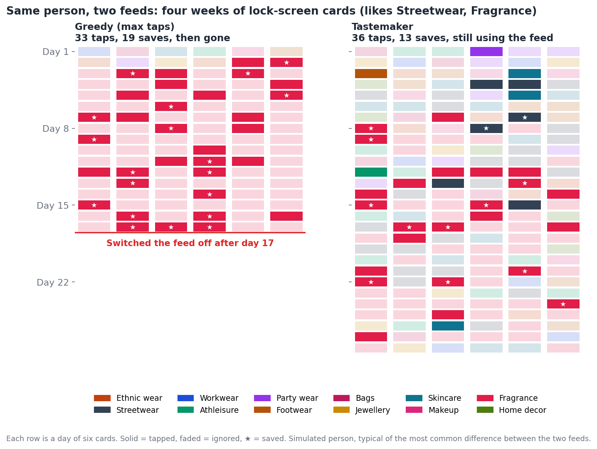
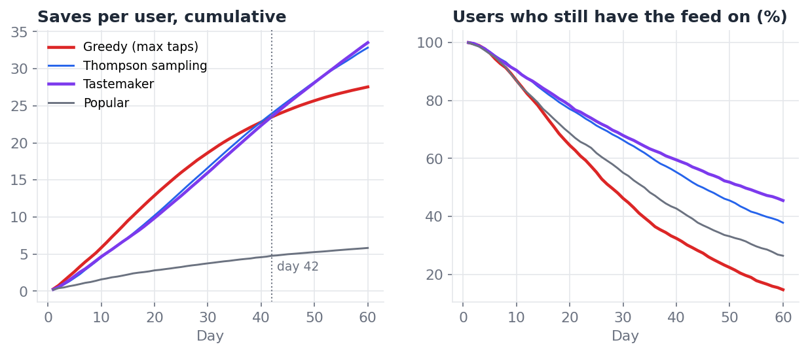
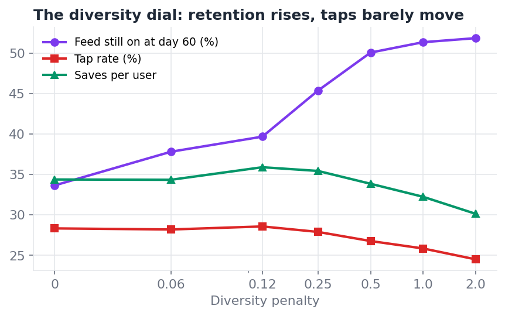
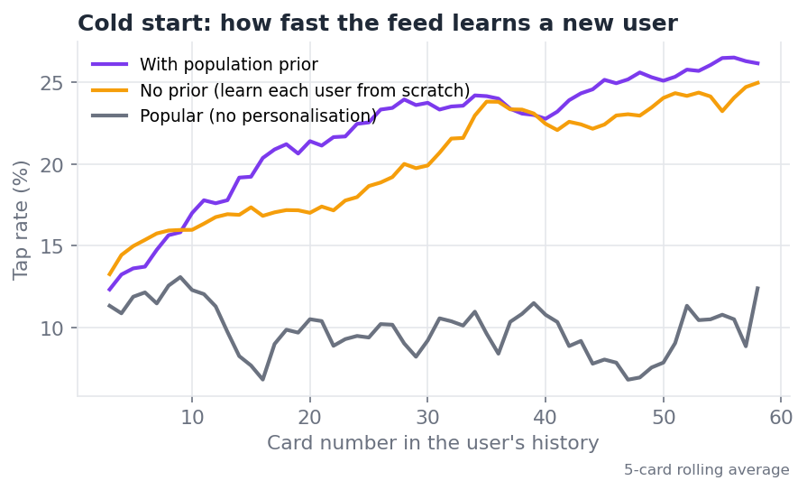
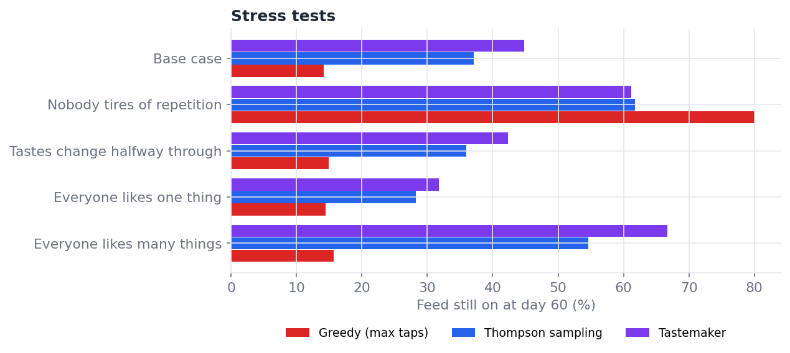
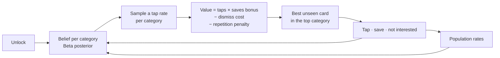

<div align="center">

# Tastemaker

**A discovery feed that learns what you like, without wearing you out.**

A personalised lock-screen feed built on Thompson sampling, a long-term value objective and a diversity guardrail, with a simulator that shows why a click-maximising feed wins every short test and loses the users.

[](https://github.com/rithi-shetty/tastemaker/actions/workflows/ci.yml) [](https://rithi-shetty.github.io/tastemaker/) [](pyproject.toml) [](LICENSE)

[**Live demo**](https://rithi-shetty.github.io/tastemaker/) · [Product brief](docs/product-brief.md) · [Results data](reports/results.json)



</div>

## Overview

Lock-screen feeds show one card per unlock to people who did not come to shop. The obvious objective, tap rate, rewards showing each person more of whatever they tapped last. It works for a week. Then the feed narrows, people get bored, and they switch it off, while the tap rate barely moves.

Tastemaker is a feed policy built for the long-term outcome, plus the simulator and experiments that test it against five alternatives on 3,000 simulated people over 60 days.

**Key results** (60 days, averaged over 3 runs):

| Metric | Click-maximiser (Greedy) | **Tastemaker** |
|---|---:|---:|
| Saves per user (intent to shop) | 27.9 | **35.5 (+27%)** |
| Feed still on at day 60 | 14% | **45%** |
| Tap rate | 28.1% | 28.0% |
| Saves in week 1 | **4.12** | 3.17 |

The click-maximiser wins week 1 and ties on tap rate, yet keeps less than a third as many users.

> [!NOTE]
> All users and behaviour are **simulated**. The central assumption, that repetition hurts retention more than it hurts taps, is stated in [`config.py`](tastemaker/config.py) and tested in [Where it does not help](#where-it-does-not-help).

## Table of contents

- [The problem](#the-problem)
- [The solution](#the-solution)
- [Results](#results)
- [Product insights](#product-insights)
- [Where it does not help](#where-it-does-not-help)
- [How it works](#how-it-works)
- [Getting started](#getting-started)
- [Project structure](#project-structure)
- [Limitations](#limitations)
- [Roadmap](#roadmap)
- [Author](#author)
- [License](#license)

## The problem

A feed has to learn each person's taste from a handful of taps, with no search query, while every irrelevant or repetitive card spends a little of their patience. Three things make this hard:

1. **Cold start.** A new user has no history.
2. **Explore vs exploit.** Showing only the current best guess stops the feed learning anything else about the person.
3. **The metric trap.** Taps are immediate and plentiful; boredom and switching off are slow and silent. A team optimising taps can make the product worse while every dashboard looks fine.

**Who it is for:** people using a lock-screen or home-screen discovery feed, the brands whose products appear in it, and the product team responsible for keeping people engaged.

## The solution

| Component | What it does |
|---|---|
| **Thompson sampling** | Keeps a belief about each person's taste per category and explores in proportion to uncertainty |
| **Population prior** | Starts new users from what most people tap, rather than from zero |
| **Value objective** | Saves count more than taps; "not interested" counts against a category |
| **Diversity guardrail** | A product rule that penalises showing one category too often in the last 12 cards, with a tunable strength |

Five baselines run on the same simulated users: Random, Popular, Greedy (always the best guess), Epsilon-greedy and plain Thompson sampling.

## Results

| Policy | Tap rate | Week-1 saves | Saves, 60 days | On at day 30 | On at day 60 | Category variety |
|---|---:|---:|---:|---:|---:|---:|
| Random | 12.1% | 1.84 | 8.2 | 61% | 33% | 98% |
| Popular | 10.2% | 1.15 | 5.6 | 49% | 21% | 70% |
| Greedy (max taps) | 28.1% | **4.12** | 27.9 | 45% | 14% | 33% |
| Epsilon-greedy | **28.5%** | 4.01 | 30.1 | 51% | 20% | 45% |
| Thompson sampling | 27.7% | 3.11 | 34.0 | 67% | 37% | 71% |
| **Tastemaker** | 28.0% | 3.17 | **35.5** | **69%** | **45%** | 74% |



- **Robust across worlds.** In 10 freshly simulated populations, Tastemaker beat Greedy on 60-day saves and retention in **all 10**, and beat plain Thompson sampling on both in all 10. Greedy won week-1 saves in all 10.
- **Typical, not cherry-picked.** Over four weeks, 33–39% of simulated users (depending on how many interests they have) leave the click-maximiser but stay with Tastemaker; 12–19% do the reverse. The demo shows one typical person from the larger group.

## Product insights

<details open>
<summary><b>1. A short test ships the wrong feed</b></summary>

| Test length | Winner on saves | Right call? |
|---|---|---|
| 1 week | Greedy | No |
| 2 weeks | Greedy | No |
| 4 weeks | Greedy | No |
| 8 weeks | Tastemaker | Yes |

Greedy leads cumulative saves until **day 42**. Feeds should be judged on retained, engaged users over at least eight weeks, with a long-running holdout after launch.
</details>

<details>
<summary><b>2. Tap rate cannot see the problem</b></summary>

Greedy and Tastemaker end with almost identical tap rates (28.1% vs 28.0%). The difference is entirely in who is still there to tap. Tap rate stays a diagnostic, never the objective.
</details>

<details>
<summary><b>3. The diversity dial has a sweet spot</b></summary>

| Penalty | Tap rate | Saves per user | On at day 60 |
|---:|---:|---:|---:|
| Off | 28.3% | 34.4 | 34% |
| 0.25 *(default)* | 27.9% | 35.4 | 45% |
| 1.0 | 25.8% | 32.2 | 51% |
| 2.0 | 24.5% | 30.1 | 52% |

Retention keeps rising with the penalty, but past about 0.25 the feed starts showing people too little of what they like, and saves fall. The default sits where saves peak; a team that values retention more would turn it up, and the trade is now explicit.


</details>

<details>
<summary><b>4. The population prior helps, but not on the first few cards</b></summary>

For roughly the first 5 cards every policy is guessing. From about card 10, starting from the population's tastes pulls ahead of learning each user from scratch, by up to 4 points of tap rate around cards 15–20. Popular, with no personalisation, never learns. Onboarding should get a few cheap signals early (for example, "pick three things you like") rather than rely on the prior alone.


</details>

<details>
<summary><b>5. Big differences are cheap to detect; small ones are not</b></summary>

Detecting the day-30 retention gap between Greedy and Tastemaker needs about **66 users per arm**. Detecting the gap between plain Thompson sampling and Tastemaker needs about **7,600 per arm**. Comparing two good policies is the expensive kind of test, so it is worth deciding up front which decisions deserve one.
</details>

## Where it does not help

| World | Saves: Greedy → Tastemaker | On at day 60: Greedy → Tastemaker | Verdict |
|---|---|---|---|
| Base case | 27.5 → 33.5 | 14% → 45% | Tastemaker wins |
| Everyone likes many things | 32.8 → 53.5 | 16% → 67% | Tastemaker wins by most |
| Tastes change halfway through | 24.8 → 28.8 | 15% → 42% | Tastemaker wins |
| Everyone likes one thing | 23.3 → 22.3 | 14% → 32% | Trade-off: fewer saves, more retention |
| **Nobody tires of repetition** | **52.5 → 38.6** | **80% → 61%** | **Click-maximiser wins** |

<sub>One run per world, so the base-case row differs slightly from the three-run average above.</sub>

If people do not get bored of repetition, the guardrail is pure cost. The whole design rests on that assumption, so the [product brief](docs/product-brief.md) makes measuring it the first step of any launch.



## How it works



**The simulator** gives each of 3,000 people one to three hidden interests, a hidden level of annoyance that rises with irrelevant and repetitive cards, and a daily chance of switching the feed off that rises with annoyance. Policies see only what a real feed logs: which card was shown and whether it was tapped, saved or dismissed. Every assumption is in [`config.py`](tastemaker/config.py).

**Tech stack:** Python (NumPy, SciPy, Matplotlib), vanilla JavaScript, pytest, GitHub Actions, GitHub Pages.

## Getting started

```bash
git clone https://github.com/rithi-shetty/tastemaker.git
cd tastemaker
python -m venv .venv
source .venv/bin/activate        # Windows: .venv\Scripts\activate
pip install -r requirements.txt
```

| Task | Command |
|---|---|
| Run every experiment and regenerate results (about 6 minutes) | `python -m tastemaker.pipeline` |
| Smaller run for CI | `python -m tastemaker.pipeline --quick` |
| Run the tests | `pytest -q` |
| Open the demo locally | `python -m http.server 8000 --directory web`, then visit http://localhost:8000 |

Every number in this README comes from `reports/results.json`. Runs are seeded and reproducible.

## Project structure

```text
tastemaker/
├── tastemaker/
│   ├── config.py        # Every assumption about the simulated users, in one place
│   ├── simulate.py      # Users, cards, responses, annoyance and switching off
│   ├── policies.py      # Random, Popular, Greedy, Epsilon, Thompson, Tastemaker
│   ├── experiments.py   # Comparison, test length, cold start, dial, robustness, stress, power
│   ├── figures.py       # README charts
│   └── pipeline.py      # End-to-end run
├── web/                 # Interactive demo (GitHub Pages)
├── tests/               # 16 tests
├── docs/                # Product brief and screenshots
└── reports/             # results.json and figures
```

## Limitations

- **Simulated people.** Tastes, annoyance and switching off follow invented rules, chosen to make the trade-offs visible rather than to match any real product's numbers.
- **The boredom assumption carries the result.** If repetition does not drive people away, Greedy wins; see the stress tests.
- **Category-level personalisation.** Within a category, cards are ranked by popularity. A production feed would personalise at the item level, with content embeddings.
- **No creative or timing effects.** Every card is equally well made, and time of day does not matter.

## Roadmap

- [x] Simulator, six policies and experiments
- [x] Interactive demo with representative examples
- [ ] Item-level personalisation with content embeddings
- [ ] Onboarding signals ("pick three things you like") for cold start
- [ ] Off-policy evaluation from logged data before running live tests
- [ ] Brand-fairness constraint on exposure

## Author

**Rithika U Shetty**, ISB PGP '27 · [GitHub](https://github.com/rithi-shetty)

Product framing, experiment design and conclusions are the author's own; AI tools assisted with code.

## License

Released under the [MIT License](LICENSE).
